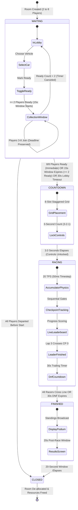

# Nitro Rush — Milestone 8.3 Acceptance Report (With Corrective Fix)
## Race Simulation & Room Lifecycle Management

**Project:** Nitro Rush — 2D Multiplayer Arcade Racing Game  
**Target:** Backend (Java 21 / Spring Boot 3.3.5 / Raw WebSocket)  
**Milestone:** 8.3 — Authoritative Race Simulation & Room Lifecycle  
**Date:** November 8, 2026  
**Status:** **PASSED & FULLY VERIFIED (Corrective Fix Incorporated)**

---

## 1. Executive Summary

Milestone 8.3 establishes the server-authoritative multiplayer race room lifecycle and connects it directly to the headless Java physics engine developed and verified in Milestone 8.2.

The backend manages a complete multiplayer race from room creation through lobby readiness, 8-slot staggered starting grid placement, 3-2-1 countdown, 20 TPS physics simulation with two-pass multi-car collisions, sequential checkpoint validation, lap completion across 3 laps, 30-second trailing-player DNF countdown, results calculation, 15-second disconnection grace, and clean room destruction.

### Milestone 8.3 Corrective Fix: Ready Collection Window
Following architecture review, the lobby transition rules in `Room.java` were updated to strictly comply with the multiplayer requirements:
1. **15-Second Collection Window:** When at least 2 players become ready, the room enters a 15-second collection window (remaining in `WAITING` state). This applies even when exactly 2 players are present and both are ready.
2. **Late Joiners (Players 3–8):** Additional players may join during this 15-second window. Joining does NOT reset or postpone the original collection deadline.
3. **Timer Cancellation:** If the number of ready players drops below 2 (e.g. a player unreadies or leaves), the collection timer is canceled and reset to 0.
4. **Immediate Start Exclusivity:** Immediate countdown initiation without waiting for the 15-second timer is triggered **exclusively** when the room reaches full capacity (8 players) and all 8 players are ready.
5. **Collection Expiration:** When the 15-second collection window expires, if at least 2 players remain ready, the room initiates the 3-second race countdown (`COUNTDOWN`).

All 119 automated tests pass with 0 failures, 0 errors, and 0 skipped tests. The Spring Boot application builds cleanly and packages a 22 MB deployable JAR.

---

## 2. New and Modified File Inventory

### Production Files Added / Updated (`Backend/src/main/`)
1. **Time Abstraction:**
   - `com.nitrorush.backend.common.TimeProvider`: Injectable deterministic time interface.
   - `com.nitrorush.backend.common.SystemTimeProvider`: Production wall-clock provider.
   - `com.nitrorush.backend.common.TestTimeProvider`: Deterministically advanceable test clock.
2. **Protocol Payloads (`com.nitrorush.backend.protocol.payload`):**
   - `SelectCarPayload.java`: Vehicle selection payload.
   - `PlayerReadyPayload.java`: Readiness toggle payload.
   - `PlayerInputPayload.java`: High-frequency client input transmission payload.
   - `ReconnectPayload.java`: 15-second grace reconnect payload.
   - `JoinMatchmakingPayload.java`: Matchmaking request payload.
   - `CancelMatchmakingPayload.java`: Lobby departure payload.
   - `RoomAssignedPayload.java`: Initial room and slot assignment payload.
   - `PlayerJoinedPayload.java`: Member joined lobby notification.
   - `PlayerLeftPayload.java`: Member left lobby notification.
   - `PlayerReadyStatusPayload.java`: Player ready/car update broadcast.
   - `CountdownStartedPayload.java`: 3-second countdown notice.
   - `RaceStartedPayload.java`: Green light race start notice.
   - `RaceStatePayload.java`: 20 Hz authoritative snapshot payload.
   - `PlayerDisconnectedPayload.java`: 15s disconnect grace broadcast.
   - `PlayerReconnectedPayload.java`: Reconnection broadcast.
   - `RaceFinishedPayload.java`: Individual finisher position and lap records.
   - `RaceResultsPayload.java`: Final match podium standings.
   - `PlayerSlotInfo.java`, `VehicleTelemetry.java`, `CompetitorResultItem.java`: DTOs.
3. **Room & Lifecycle Engine (`com.nitrorush.backend.room`):**
   - `RoomState.java`: WAITING, COUNTDOWN, RACING, FINISHED, CLOSED state enum.
   - `PlayerSlot.java`: Encapsulates racer slot, session ID, inputs, and grace deadlines.
   - `MultiplayerGridConfig.java`: 8-slot staggered collision-free starting grid geometry.
   - `MessageBroadcaster.java`: WebSocket message routing abstraction.
   - `WebSocketMessageBroadcaster.java`: Production broadcaster delegating to ConnectionManager.
   - `Room.java`: Per-room state machine, physics runner, snapshot broadcaster, and corrected collection window logic.
   - `RoomManager.java`: Thread-safe registry and session router for all active rooms.
   - `RoomTickerService.java`: 20 TPS (50ms) background scheduler.
4. **Race Progress Tracking (`com.nitrorush.backend.race`):**
   - `CompetitorProgress.java`: Per-player checkpoint, lap, and timing state.
   - `RaceProgressTracker.java`: 2D gate intersection, sequential clearing, and 30s DNF countdown.
5. **WebSocket & Core Integration:**
   - `com.nitrorush.backend.protocol.ErrorCode`: Added missing error codes.
   - `com.nitrorush.backend.websocket.GameWebSocketHandler`: Wired room protocol actions.
   - `com.nitrorush.backend.NitroRushApplication`: Enabled `@EnableScheduling`.

### Test Files Added / Updated (`Backend/src/test/`)
1. `com.nitrorush.backend.room.RoomLifecycleTest.java`: 17 tests (11 base lifecycle tests + 6 dedicated regression tests for corrective fix).
2. `com.nitrorush.backend.race.RaceProgressTrackerTest.java`: 7 tests.
3. `com.nitrorush.backend.room.RoomSimulationTest.java`: 6 tests.
4. `com.nitrorush.backend.room.RoomConnectionLifecycleTest.java`: 5 tests.
5. `com.nitrorush.backend.room.RoomConcurrencyTest.java`: 3 tests.
6. `com.nitrorush.backend.websocket.RoomWebSocketIntegrationTest.java`: Full lobby WebSocket test.
7. `com.nitrorush.backend.websocket.GameWebSocketHandlerTest.java`: Updated constructor injection.

---

## 3. Room Lifecycle State Transitions



---

## 4. WebSocket Message Integration

| Direction | Message Type | Purpose & Payload |
| :--- | :--- | :--- |
| **Client \(\to\) Server** | `SELECT_CAR` | Select vehicle (`bolt-gt`, `viper-r`, `rally-apex`, `titan-v8`). |
| **Client \(\to\) Server** | `PLAYER_READY` | Confirms ready status in lobby (`isReady: boolean`). |
| **Client \(\to\) Server** | `PLAYER_INPUT` | High-frequency input (`throttle, brake, steer, drift, nitro, seq`). |
| **Client \(\to\) Server** | `RECONNECT` | 15s grace reconnect attempt (`roomId, guestToken, lastKnownTick`). |
| **Server \(\to\) Client** | `ROOM_ASSIGNED` | Room and slot assignment (`roomId, trackId, slotId, players`). |
| **Server \(\to\) Client** | `PLAYER_JOINED` | Notifies lobby that another player joined (`player: PlayerSlotInfo`). |
| **Server \(\to\) Client** | `PLAYER_LEFT` | Notifies lobby that a player departed (`playerId, slot`). |
| **Server \(\to\) Client** | `PLAYER_READY_STATUS` | Broadcasts car/ready updates (`playerId, isReady, carId`). |
| **Server \(\to\) Client** | `COUNTDOWN_STARTED` | 3-second countdown signal (`durationSeconds: 3`). |
| **Server \(\to\) Client** | `RACE_STARTED` | Controls unlocked, race began (`serverTimestamp`). |
| **Server \(\to\) Client** | `RACE_STATE` | 20 Hz authoritative snapshot (`serverTick, ackInputSeq, vehicles`). |
| **Server \(\to\) Client** | `PLAYER_DISCONNECTED` | 15s grace countdown alert (`playerId, graceTimeRemainingSec: 15`). |
| **Server \(\to\) Client** | `PLAYER_RECONNECTED` | Notification that racer returned (`playerId`). |
| **Server \(\to\) Client** | `RACE_FINISHED` | Finisher timing packet (`position, totalTimeMs, bestLapMs, lapTimes`). |
| **Server \(\to\) Client** | `RACE_RESULTS` | Match conclusion podium standings (`trackId, results[]`). |

---

## 5. Test Execution Evidence

### Test Suite Execution Output
```text
[INFO] -------------------------------------------------------
[INFO]  T E S T S
[INFO] -------------------------------------------------------
[INFO] Running com.nitrorush.backend.NitroRushApplicationTests
[INFO] Tests run: 1, Failures: 0, Errors: 0, Skipped: 0
[INFO] Running com.nitrorush.backend.physics.PhysicsBenchmarkTest
[INFO] Tests run: 1, Failures: 0, Errors: 0, Skipped: 0
[INFO] Running com.nitrorush.backend.physics.PhysicsConformanceTest
[INFO] Tests run: 9, Failures: 0, Errors: 0, Skipped: 0
[INFO] Running com.nitrorush.backend.physics.PhysicsRegressionTest
[INFO] Tests run: 40, Failures: 0, Errors: 0, Skipped: 0
[INFO] Running com.nitrorush.backend.protocol.ProtocolSerializationTest
[INFO] Tests run: 7, Failures: 0, Errors: 0, Skipped: 0
[INFO] Running com.nitrorush.backend.race.RaceProgressTrackerTest
[INFO] Tests run: 7, Failures: 0, Errors: 0, Skipped: 0
[INFO] Running com.nitrorush.backend.room.RoomConcurrencyTest
[INFO] Tests run: 3, Failures: 0, Errors: 0, Skipped: 0
[INFO] Running com.nitrorush.backend.room.RoomConnectionLifecycleTest
[INFO] Tests run: 5, Failures: 0, Errors: 0, Skipped: 0
[INFO] Running com.nitrorush.backend.room.RoomLifecycleTest
[INFO] Tests run: 17, Failures: 0, Errors: 0, Skipped: 0
[INFO] Running com.nitrorush.backend.room.RoomSimulationTest
[INFO] Tests run: 6, Failures: 0, Errors: 0, Skipped: 0
[INFO] Running com.nitrorush.backend.session.GuestSessionManagerTest
[INFO] Tests run: 6, Failures: 0, Errors: 0, Skipped: 0
[INFO] Running com.nitrorush.backend.websocket.ConnectionManagerTest
[INFO] Tests run: 10, Failures: 0, Errors: 0, Skipped: 0
[INFO] Running com.nitrorush.backend.websocket.GameWebSocketHandlerTest
[INFO] Tests run: 7, Failures: 0, Errors: 0, Skipped: 0
[INFO] 
[INFO] Results:
[INFO] 
[INFO] Tests run: 119, Failures: 0, Errors: 0, Skipped: 0
[INFO] 
[INFO] ------------------------------------------------------------------------
[INFO] BUILD SUCCESS
[INFO] ------------------------------------------------------------------------
```

### 5.1 Corrective Fix Dedicated Regression Tests (`RoomLifecycleTest.java`)
The 6 dedicated regression test methods verifying the corrected ready collection window behavior:
1. `testExactlyTwoReadyPlayersRemainsWaitingDuringCollectionWindow()`: Asserts that when exactly 2 joined players both toggle ready, the room strictly remains in `WAITING` state throughout the 15-second collection window (tested at $t=10\text{ s}$).
2. `testExactlyTwoReadyPlayersTransitionsToCountdownAfter15Seconds()`: Asserts that when 15.1 seconds elapse with exactly 2 ready players, the room successfully transitions to `COUNTDOWN`.
3. `testAdditionalPlayersJoiningDoNotResetOriginalDeadline()`: Asserts that when Player 3 joins at $t=5\text{ s}$ during an ongoing collection window started at $t=0$, the original deadline ($t=15\text{ s}$) is preserved rather than postponed. At $t=15.1\text{ s}$, `COUNTDOWN` begins.
4. `testReachingEightPlayersWithAllReadyStartsImmediately()`: Asserts that immediate transition to `COUNTDOWN` occurs exclusively when all 8 room slots are filled and all 8 players are ready.
5. `testReadyCountDroppingBelowTwoCancelsTimer()`: Asserts that if ready count drops to 1, the 15-second collection timer is canceled (`readyCountdownStartedAtMs == 0`) and the room remains in `WAITING`.
6. `testReadyCountRemainingAtLeastTwoPreservesOriginalDeadline()`: Asserts that if 3 players ready up and one unreadies at $t=5\text{ s}$, because 2 players remain ready, the original deadline ($t=15\text{ s}$) is preserved and triggers `COUNTDOWN` at $t=15.1\text{ s}$.

### Packaging & Artifact Verification
```text
$ ls -lh Backend/target/backend-0.0.1-SNAPSHOT.jar
-rw-r--r--@ 1 hasinnn  staff    22M Nov  8 14:13 Backend/target/backend-0.0.1-SNAPSHOT.jar
```

---

## 6. Known Limitations and Out-of-Scope Items

1. **Global Public Matchmaking Queue:** As explicitly specified in the milestone objective, global matchmaking queueing across tracks is scheduled for Milestone 8.4/8.6.
2. **Frontend Networking & UI:** Frontend integration in `Frontend/src/multiplayer/` will be implemented in Milestone 8.4.
3. **No External Databases:** Persistence is memory-backed per architectural specification; no Redis or MongoDB has been introduced.

