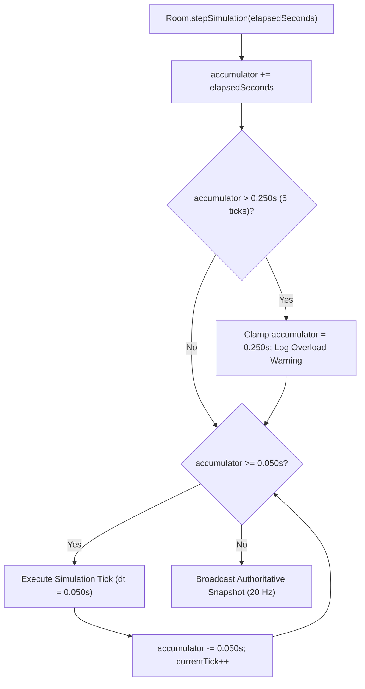

# Nitro Rush — Authoritative Race Simulation & Progress Tracking
## Milestone 8.3: Server-Side Simulation Engine & Verification

---

## 1. Authoritative Architecture Overview

Nitro Rush employs a strict server-authoritative racing model:
- **Server Owns Truth:** The server simulates all vehicles, evaluates pairwise collisions, advances checkpoint and lap progression, and computes finish positions.
- **Client Sends Inputs Only:** Clients transmit high-frequency `PLAYER_INPUT` packets (`throttle`, `brake`, `steer`, `drift`, `nitro`, `sequenceNumber`). Client-reported positions or kinematics are never accepted.
- **Fixed Timestep (20 TPS):** Simulation advances strictly in 50 ms discrete steps ($\Delta t = 0.050\text{ s}$). Variable timesteps are strictly prohibited to preserve numerical integration stability.
- **Downlink Snapshots (20 Hz):** Server broadcasts compact `RACE_STATE` JSON packets containing authoritative coordinates, velocities, headings, nitro amounts, drift flags, and input acknowledgment sequences (`ackInputSeq`).

---

## 2. Fixed-Timestep Accumulator & Overload Clamping

The simulation loop decouples wall-clock elapsed time from internal physics integration using `FixedTimestepRunner`:

### Invariants:
1. **Clock Integrity:** Race simulation time and tick indices advance *strictly* when physics steps execute. Simulation clock never jumps ahead without physics execution.
2. **Anti-Spiral of Death:** If server experiences a stall exceeding 250 ms, excess wall-clock time is safely dropped, bounding catch-up iterations to at most 5 ticks per frame.

---

## 3. Checkpoint Validation & Anti-Shortcut Rules

Checkpoints are loaded from `TrackRegistry` using the 12 geometric track gates.

### 3.1 Line Segment Intersection Math
A checkpoint crossing is tested by checking 2D line segment intersection between the vehicle's trajectory $[(x_1, y_1) \to (x_2, y_2)]$ and the checkpoint gate line $[G_1 \to G_2]$:
- Gate endpoints:
  $$gx_1 = cp_x - \text{norm}_x \cdot W_{\text{half}}, \quad gy_1 = cp_y - \text{norm}_y \cdot W_{\text{half}}$$
  $$gx_2 = cp_x + \text{norm}_x \cdot W_{\text{half}}, \quad gy_2 = cp_y + \text{norm}_y \cdot W_{\text{half}}$$
  where $\vec{n} = (-\sin\theta, \cos\theta)$ and $W_{\text{half}} = \frac{W}{2} + \max(36, \text{round}(\frac{W}{2} \cdot 0.52))$.
- Parametric intersection solution:
  $$\text{denom} = -s_{2x} \cdot s_{1y} + s_{1x} \cdot s_{2y}$$
  $$s = \frac{-s_{1y} \cdot (x_1 - gx_1) + s_{1x} \cdot (y_1 - gy_1)}{\text{denom}}, \quad t = \frac{s_{2x} \cdot (y_1 - gy_1) - s_{2y} \cdot (x_1 - gx_1)}{\text{denom}}$$
  Intersection holds if $s \in [0, 1] \land t \in [0, 1]$.
- Forward direction enforcement:
  $$(x_2 - x_1) \cdot \cos\theta + (y_2 - y_1) \cdot \sin\theta > 0.01$$

### 3.2 Sequential Progression & Lap Rules
1. **Initial Start Line Crossing:** Vehicles spawn behind Checkpoint 0. Driving forward across Checkpoint 0 clears `hasCrossedStartLine`, marks CP 0 cleared, and advances `nextCheckpointIndex` to 1.
2. **Strict Order:** An intermediate checkpoint $i$ can *only* be cleared if $i == \text{nextCheckpointIndex}$. Skipping checkpoints is rejected.
3. **Lap Completion:** Checkpoint 0 can only complete a lap if at least $N - 1$ intermediate checkpoints were cleared during the current lap. This eliminates all shortcut exploits.
4. **Race Completion:** Completing Lap 3 flags the racer as `FINISHED`, records their finishing position ($1 \dots 8$) and lap times, and triggers the 30-second trailing-player DNF countdown.

---

## 4. Live Progress Scoring & Leaderboard Ranking

Continuous progress scores are computed for every active competitor each tick:
- **Finished Racers:** $1,000,000 - (\text{finishPosition} \times 10,000)$.
- **Active Racers:**
  $$\text{score} = (\text{lap} - 1) \times 20,000 + |\text{clearedCheckpoints}| \times 1,000 + \max(0, 1,000 - d_{\text{nextCp}})$$
- **Leaderboard Sort Order:**
  1. Finished racers sorted ascending by finish position.
  2. Active racers sorted descending by progress score.
  3. DNF racers sorted by progress score behind finished racers.

---

## 5. Post-Winner 30-Second DNF Countdown

1. When the 1st place competitor crosses the finish line on Lap 3:
   - Winner receives `RACE_FINISHED` with 1st place confirmation.
   - The server activates a **30-second post-winner countdown**.
2. Any player who completes Lap 3 before the 30-second timer expires receives their actual finishing position (2nd, 3rd, 4th, etc.).
3. When the 30-second timer hits zero:
   - Any racers who have not completed Lap 3 are immediately flagged as `DNF`.
   - `DNF` players are ranked behind all finished racers, ordered by their total progress score.
   - The room transitions immediately to `FINISHED` and broadcasts `RACE_RESULTS`.

