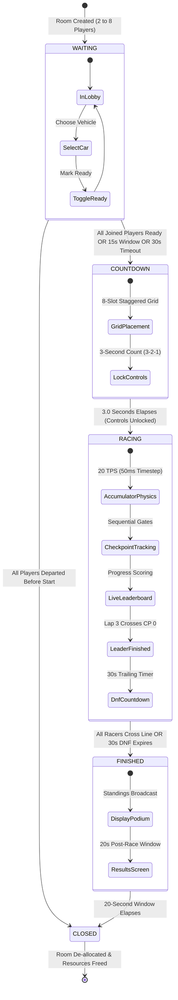

# Nitro Rush — Room Lifecycle Architecture & State Machine
## Milestone 8.3: Server-Side Room Lifecycle Specification

---

## 1. Overview

The multiplayer room lifecycle in Nitro Rush manages the complete progression of a racing session, orchestrating player slots, readiness synchronization, starting grid positioning, countdown timing, and graceful cleanup.

---

## 2. Room State Machine

A room transitions deterministically across five formal states:

### 2.1 State Definitions & Transition Invariants

| State | Entry Conditions | Allowed Client Actions | Server Operations & Invariants | Exit Triggers |
| :--- | :--- | :--- | :--- | :--- |
| **`WAITING`** | Room allocated with track. | `SELECT_CAR`, `PLAYER_READY`, `CANCEL_MATCHMAKING`. | Listens for vehicle selections and ready flags. Manages 30s lobby timeout and 15s collection countdown when $\ge 2$ players are ready. Rejects 9th player with `ROOM_FULL`. | **To `COUNTDOWN`:** All joined players are ready ($\ge 2$), or 15s ready collection window expires ($\ge 2$ ready), or 30s lobby timeout expires ($\ge 2$ ready). **To `CLOSED`:** All players depart. |
| **`COUNTDOWN`** | Lobby readiness conditions met. | None (controls locked). | Spawns vehicles on the 8-slot staggered starting grid (`P1`–`P8`). Locks velocities and controls to zero. Broadcasts `COUNTDOWN_STARTED` (duration: 3s). Ticks 3.0s timer. | **To `RACING`:** Exactly 3.0 seconds elapse. Broadcasts `RACE_STARTED`. |
| **`RACING`** | 3.0s countdown reaches zero. | `PLAYER_INPUT` (throttle, brake, steer, drift, nitro), `RECONNECT`. | Executes accumulator-based 20 TPS physics loop ($\Delta t = 50\text{ ms}$), 2-pass multi-car collisions, checkpoint tracking, lap completion, and 20 Hz `RACE_STATE` snapshot broadcasts. Manages 15s disconnect grace and 30s DNF timer. | **To `FINISHED`:** All active racers finish 3 laps, or 30s post-winner DNF countdown hits zero. |
| **`FINISHED`** | All active racers finished or flagged DNF. | None (inspect final results). | Calculates final standings, flags incomplete racers as `DNF`, stops physics ticks, broadcasts `RACE_RESULTS`. Ticks 20s display timer. | **To `CLOSED`:** 20 seconds elapse. |
| **`CLOSED`** | Results window expires or room aborted. | Disconnected. | Unregisters room from `RoomManager`, disposes simulation instances, cleans session mappings. | Room removed from memory. |

---

## 3. Starting Grid Alignment (8-Slot Staggered Configuration)

Vehicles are spawned on a dedicated 8-slot staggered grid behind Checkpoint 0:
- **Heading:** Aligned with Checkpoint 0 angle $\theta_0$.
- **Longitudinal Spacing:** $d_{\text{long}} = 90.0 + (i \times 60.0)\text{ px}$ behind Checkpoint 0 (for $i \in \{0 \dots 7\}$).
- **Lateral Alignment:** $d_{\text{lat}} = (i \% 2 == 0) ? -28.0\text{ px} : +28.0\text{ px}$.
- **Clearance:** Minimum diagonal distance between adjacent slots is $\sqrt{60^2 + 56^2} \approx 82.07\text{ px} > 44\text{ px}$ collision diameter. This guarantees **zero initial collisions** on race start.

---

## 4. Disconnection & 15-Second Reconnection Lifecycle

When a player loses connection during `RACING`:
1. Player connection is unbound; `PlayerSlot.connected` is set to `false`.
2. A 15-second grace deadline is assigned (`reconnectDeadlineMs = now + 15000`).
3. Disconnected vehicle continues along its momentum vector subject to standard road drag (`0.988`) with inert neutral inputs (`throttle = 0, brake = 0, steer = 0, drift = false, nitro = false`). Collision radius remains active.
4. Server broadcasts `PLAYER_DISCONNECTED` (`playerId`, `graceTimeRemainingSec: 15`) to room members.
5. If player reconnects within 15 seconds:
   - Client sends `RECONNECT` payload with authenticated guest token.
   - Server rebinds session, cancels grace deadline, sends immediate `RACE_STATE` resynchronization snapshot, and broadcasts `PLAYER_RECONNECTED`.
6. If 15 seconds elapse without reconnection:
   - Player is marked `status = "DNF"`.
   - `reconnectExpired` flag is set, permanently blocking late reconnection attempts with `SESSION_EXPIRED`.

---

## 5. Concurrency & Reliability Architecture

- **Per-Room Synchronization:** Mutex locks (`stateLock`) prevent race conditions during concurrent joins, ready toggles, vehicle selections, and state transitions.
- **Capacity Protection:** Exactly 8 players can join; excess concurrent joins are rejected with `ROOM_FULL`.
- **Session Isolation:** A player can only send inputs to their assigned slot. Spoofing player IDs without matching the authenticated guest token is rejected with `INVALID_CREDENTIALS` or `INVALID_RECONNECT_TOKEN`.
- **Fault Isolation:** `RoomManager.tick()` isolates room execution in try-catch blocks; an unexpected error in one room never crashes other rooms or the server thread.
- **Safe Cleanup:** `cleanupClosedRooms()` removes only rooms with state `CLOSED`. Active races are never removed.

