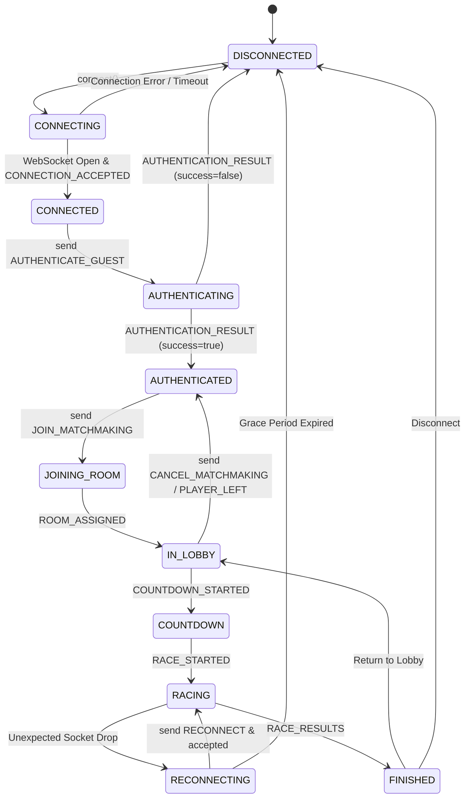
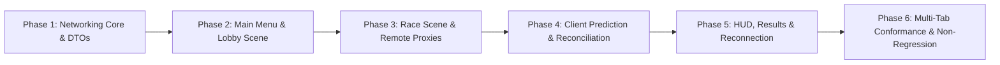

# Nitro Rush — Milestone 8.4 Implementation Plan
## Frontend-Backend Multiplayer Integration Architecture & Audit

**Document Version:** 1.0.0  
**Status:** DRAFT — AWAITING EXPLICIT USER APPROVAL  
**Scope:** Milestone 8.4 Planning & Architecture Audit Only (No code modifications permitted)  
**Target Backend:** Java Spring Boot 3.4.5 (`com.nitrorush.backend`) over raw WebSocket Protocol v1.0  
**Target Frontend:** Phaser 3.90.0 TypeScript (`Frontend/src/`)  

---

## 1. Executive Summary & Objective

### 1.1 Objective
The objective of **Milestone 8.4** is to integrate the existing, completed single-player Phaser 3.90.0 TypeScript frontend with the completed Java Spring Boot authoritative multiplayer backend. This enables real-time 2-to-8 player competitive multiplayer racing over raw WebSockets while preserving 100% of the single-player gameplay, offline racing capabilities, vehicle physics, track definitions, visual effects, and UI audio intact.

### 1.2 Boundary & Constraint Enforcement
1. **Strict Planning Mode:** This document is an architecture audit and implementation roadmap. No production source code, configuration files, or build artifacts are modified during this phase.
2. **Single-Player Preservation:** The single-player offline game (`MainMenuScene` $\to$ `TrackSelectScene` $\to$ `GarageScene` $\to$ `RaceScene` $\to$ `ResultsScene`) must remain completely undisturbed and functional with zero network dependencies.
3. **No External Infrastructure:** No Redis, MongoDB, Docker, Kubernetes, or cloud services (AWS/GCP) will be introduced. All backend room state, sessions, and physical simulations remain in-memory within the Spring Boot application.
4. **Protocol v1.0 Adherence:** The client communicates over standard browser WebSockets (`ws://<host>:8080/ws/game`) strictly using JSON envelopes conforming to Protocol v1.0. No STOMP, SockJS, or third-party RPC frameworks are used.
5. **No Invented Backend Capabilities:** Global matchmaking queues across arbitrary tracks are reserved for Milestone 8.6. Milestone 8.4 leverages the existing, verified backend room allocation mechanism (`JOIN_MATCHMAKING` with `preferredTrackId`, `preferredCarId`, and optional `roomId`).
6. **Implementation Gate:** Work on implementation phases will not begin without explicit user review and written approval.

---

## 2. Frontend Architecture & Single-Player Isolation Analysis

### 2.1 Inspection of Existing Frontend Source Tree
The frontend codebase was audited across all directories:
- `Frontend/src/main.ts`: Initializes `Phaser.Game(gameConfig)` and exposes `window.__NITRO_GAME__` in development mode.
- `Frontend/src/game/GameConfig.ts`: Defines viewport dimensions (1280x720 FIT / CENTER_BOTH), Arcade Physics (gravity: 0, debug: false), and registers active scenes:
  `[BootScene, MainMenuScene, TrackSelectScene, GarageScene, RaceScene, ResultsScene]`.
- `Frontend/src/scenes/MainMenuScene.ts` (952 lines): Cyberpunk animated background, hero car turntable display, audio unlock handler (`SoundEffects.unlock()`), and chamfered action buttons (`PLAY RACE`, `GARAGE`, `SETTINGS`).
- `Frontend/src/scenes/TrackSelectScene.ts` (920 lines): Interactive track selector for all 9 tracks, 3 difficulty tiers (CASUAL, GRID COMPETITOR, APEX MASTER), and transition to `GarageScene`.
- `Frontend/src/scenes/GarageScene.ts` (890 lines): 4 vehicle selectors (`bolt-gt`, `viper-r`, `phantom-ex`, `rally-apex`), stat radar previews, and race confirmation modal launching `RaceScene`.
- `Frontend/src/scenes/RaceScene.ts` (1,876 lines): High-performance single-player race environment:
  - Builds `CircuitTrack` from `TrackGeometry`.
  - Spawns player vehicle via `CarController` at grid position P1.
  - Spawns 3 `AIController` opponents at grid positions P2, P3, P4.
  - Manages 2-pass pairwise collision physics (impulse pass + positional relaxation solver).
  - Handles 3-2-1-GO countdown, persistent skid mark fading buffers, tire smoke/exhaust particles, and dynamic camera follow.
  - Drives HUD: speed arc, nitro meter, lap counter, split timers, mini-leaderboard (4 cars), vector minimap, wrong-way overlay.
  - Emits race completion to `ResultsScene`.
- `Frontend/src/game/CarController.ts` (611 lines): Authoritative client physics model for single-player with tire friction, drift qualification, mini-turbo boosting, brake-hold reverse, and surface physics.
- `Frontend/src/game/RaceManager.ts` (458 lines): Checkpoint gate tracking, lap timing, leaderboard sorting, and `RaceResultData` construction.
- `Frontend/src/state/SelectionState.ts` (96 lines): In-memory singleton managing `selectedTrackId`, `selectedCarId`, `selectedDifficulty`, and `returnScene`.

### 2.2 Single-Player Isolation & Non-Regression Strategy
To eliminate any possibility of breaking or destabilizing the single-player game, multiplayer will **not** be injected by modifying or branching inside `RaceScene.ts`.

Instead, the architecture adopts a **Strict Scene Separation Strategy**:
1. **Dedicated Multiplayer Entry Point:** `MainMenuScene.ts` will receive an additional "MULTIPLAYER" button styled identically to existing cyber buttons. Clicking it opens the multiplayer scene graph without modifying the single-player flow.
2. **Dedicated Scene Additions:**
   - `MultiplayerLobbyScene.ts`: Manages guest authentication, track selection, room join/creation, 8-player slot visualization, car selection, and readiness toggling.
   - `MultiplayerRaceScene.ts`: Dedicated multiplayer racing scene that reuses the visual rendering pipeline (`CircuitTrack`, shaders, minimap, particles, audio), but replaces local AI and local race management with client-side prediction, server reconciliation, and remote vehicle snapshot interpolation.
3. **Preservation of Single-Player:**
   - Single-player button `PLAY RACE` continues navigating `TrackSelectScene` $\to$ `GarageScene` $\to$ `RaceScene` $\to$ `ResultsScene`.
   - `RaceScene.ts`, `AIController.ts`, and single-player `RaceManager.ts` are left untouched.
   - Offline play continues functioning even when the backend server is completely offline.

```mermaid
flowchart TD
    subgraph SinglePlayerFlow ["Untouched Single-Player Scene Flow"]
        MM[MainMenuScene] -->|PLAY RACE| TS[TrackSelectScene]
        TS -->|SELECT CAR| GS[GarageScene]
        GS -->|START RACE| RS[RaceScene (Local AI, Local Physics)]
        RS -->|FINISH| RES[ResultsScene]
        RES -->|RETRY / MENU| MM
    end

    subgraph MultiplayerFlow ["New Milestone 8.4 Multiplayer Scene Flow"]
        MM -->|MULTIPLAYER| MLS[MultiplayerLobbyScene]
        MLS -->|DISCONNECT / BACK| MM
        MLS -->|COUNTDOWN / START| MRS[MultiplayerRaceScene]
        MRS -->|RACE FINISH| MRES[ResultsScene (Multiplayer Mode)]
        MRES -->|RETURN TO LOBBY| MLS
        MRES -->|RETURN TO MENU| MM
    end
```

---

## 3. Backend Architecture & Ground-Truth Protocol Audit

### 3.1 Backend Source Inspection
The Java backend (`Backend/src/main/java/com/nitrorush/backend/`) was audited to establish ground-truth behavior:
- `WebSocketConfig.java`: Registers raw WebSocket handler at path `/ws/game` with allowed origins `*`.
- `GameWebSocketHandler.java` (346 lines):
  - Validates frame sizes $\le 65,536$ bytes.
  - Requires `protocolVersion: "1.0"`.
  - Dispatches inbound messages via `MessageType` switch.
  - Dispatches `CONNECTION_ACCEPTED` immediately upon connection open (`heartbeatIntervalMs = 10,000`).
  - Handles guest authentication via `GuestSessionManager`.
  - Handles room allocation, car selection, ready status, player inputs, and reconnection via `RoomManager`.
- `RoomManager.java` (215 lines): Manages thread-safe concurrent collection of `Room` instances.
- `Room.java` (707 lines): Manages room lifecycle states (`WAITING`, `COUNTDOWN`, `RACING`, `FINISHED`, `CLOSED`), 8 player slots (P1..P8), 15-second ready collection timer, 3-second countdown timer, 20 Hz fixed timestep simulation loop, 2-pass collision resolution, checkpoint gating, individual `RACE_FINISHED` events, aggregate `RACE_RESULTS`, and 15-second disconnection grace timers.
- `MultiplayerGridConfig.java`: Generates 8 staggered grid slots behind Checkpoint 0 with longitudinal row spacing of 60px and alternating lateral offset of $\pm 28\text{px}$.

### 3.2 Protocol Envelope & Framing
Every message between client and server adheres to `MessageEnvelope<T>`:
```json
{
  "protocolVersion": "1.0",
  "type": "<MESSAGE_TYPE>",
  "timestamp": 1731056400000,
  "payload": { ... }
}
```

### 3.3 Server Timings & Frequencies
- **Heartbeat:** 10,000 ms (10 seconds) interval.
- **Physics Simulation Rate:** 20 Hz (fixed timestep of $\Delta t = 50\text{ ms}$).
- **State Broadcast Frequency:** 20 Hz (one `RACE_STATE` snapshot broadcast every 50ms).
- **Ready Collection Window:** 15.0 seconds (starts when $\ge 2$ players are ready).
- **Countdown Duration:** 3.0 seconds (`COUNTDOWN_STARTED`).
- **DNF Timeout:** 30.0 seconds (triggered when first racer crosses the finish line).
- **Disconnection Grace Window:** 15.0 seconds (slot held for `RECONNECT`).

---

## 4. Frontend Networking Architecture (`Frontend/src/multiplayer/`)

A dedicated, modular networking package will be established in `Frontend/src/multiplayer/`.

```
Frontend/src/multiplayer/
├── NetworkManager.ts          # Singleton WebSocket manager & event dispatcher
├── SessionStore.ts            # LocalStorage persistence for guest tokens & user profile
├── InputHistoryBuffer.ts      # Ring buffer of local predicted inputs & physics states
├── SnapshotInterpolator.ts    # Jitter buffer & interpolation engine for remote cars
├── RemoteCarProxy.ts          # Visual proxy representation for remote competitors
└── protocol/
    ├── MessageTypes.ts        # Inbound and outbound message type enums
    ├── ProtocolTypes.ts       # TypeScript interfaces matching Jackson payloads
    └── ProtocolEnvelope.ts    # Envelope builder & parser
```

### 4.1 Connection State Machine
The client connection is governed by a strict state machine inside `NetworkManager.ts`:



### 4.2 NetworkManager Capabilities
1. **Raw WebSocket Lifecycle:**
   - Opens standard `WebSocket` to `ws://localhost:8080/ws/game` (configurable via environment variable `VITE_WS_URL` with sensible default to `window.location.hostname:8080`).
   - Automatically parses incoming JSON frames into typed envelopes.
   - Throws clear error events on malformed payloads.
2. **Heartbeat Management:**
   - On receiving `CONNECTION_ACCEPTED(heartbeatIntervalMs)`, starts an interval timer sending `PING` with `clientTimestamp = Date.now()`.
   - On receiving `PONG`, calculates round-trip time: $\text{RTT} = \text{Date.now()} - \text{clientTimestamp}$, making smoothed latency (ping) available to the UI.
3. **Session & Guest Handling:**
   - Reads existing `guestToken` from `SessionStore` (or generates a random guest name like `Racer_742`).
   - Authenticates via `AUTHENTICATE_GUEST`.
   - Stores authenticated `guestToken` in `SessionStore` for automatic reconnection.
4. **Strongly-Typed Event Dispatcher:**
   - Provides type-safe subscription: `networkManager.on<T>(MessageType.RACE_STATE, (payload) => ...)`.
   - Supports clean scene unsubscription (`networkManager.off(...)`) on scene transition to prevent memory leaks.

---

## 5. Multiplayer Lobby Design & Flow

### 5.1 User Journey & Visual Hierarchy
1. **Entry from Main Menu:**
   - A new cyber button `MULTIPLAYER` is placed on `MainMenuScene` between `PLAY RACE` and `GARAGE`.
   - Clicking it checks connection; if disconnected, connects and transitions to `MultiplayerLobbyScene`.
2. **Multiplayer Lobby Scene Layout (1280x720):**
   - **Header Bar:**
     - Left: Game title and connection status pill (e.g. `● ONLINE (18ms)`).
     - Center: Room status banner (e.g. `ROOM: #coastal-rush-9102 // WAITING FOR RACERS`).
     - Right: Exit / Leave button (sends `CANCEL_MATCHMAKING` and returns to `MainMenuScene`).
   - **Main Area — 8 Player Slot Cards (2 rows of 4 cards):**
     - Each card displays:
       - Slot Badge: `P1` through `P8`.
       - Driver Name: Player display name (local player highlighted in neon cyan `0x00f0ff`).
       - Vehicle Preview: Mini sprite of selected vehicle (`bolt-gt`, `viper-r`, `phantom-ex`, `rally-apex`).
       - Status Pill: `READY` (green), `SELECTING` (amber), or `OPEN SLOT` (gray dashed outline).
       - Ping indicator for connected players.
   - **Footer Control Panel:**
     - **Track Selection / Display:** Shows track name and mini-thumbnail.
     - **Car Selector Bar:** Chamfered buttons to cycle vehicles (`bolt-gt`, `viper-r`, `phantom-ex`, `rally-apex`). Clicking one immediately sends `SELECT_CAR`.
     - **Ready Toggle Button:** Large high-contrast cyber button (`READY UP` / `CANCEL READY`). Sends `PLAYER_READY`.
     - **Collection Window Timer:** When $\ge 2$ players are ready, a 15-second countdown banner appears: `RACE STARTING IN 14s... (ADDITIONAL PLAYERS MAY JOIN)`.
   - **Countdown Overlay:**
     - When `COUNTDOWN_STARTED` arrives (duration: 3s), the screen darkens with a high-energy animated 3-2-1-GO overlay matching the single-player audio beeps (`SoundEffects.playCountdownBeep`).
     - On `RACE_STARTED`, cleanly transitions to `MultiplayerRaceScene`.

```
+-----------------------------------------------------------------------------------------+
| [◄ LEAVE]   NITRO RUSH MULTIPLAYER // ROOM #CR-4401        [● ONLINE | PING: 24ms]      |
+-----------------------------------------------------------------------------------------+
|  +----------------+  +----------------+  +----------------+  +----------------+         |
|  | P1: ApexPred   |  | P2: CyberDrift |  | P3: You (Ghost)|  | P4: [OPEN]     |         |
|  | Car: VIPER-R   |  | Car: BOLT-GT   |  | Car: RALLY-APX |  |                |         |
|  | [✓ READY]      |  | [✓ READY]      |  | [SELECTING]    |  | WAITING...     |         |
|  +----------------+  +----------------+  +----------------+  +----------------+         |
|  +----------------+  +----------------+  +----------------+  +----------------+         |
|  | P5: [OPEN]     |  | P6: [OPEN]     |  | P7: [OPEN]     |  | P8: [OPEN]     |         |
|  +----------------+  +----------------+  +----------------+  +----------------+         |
+-----------------------------------------------------------------------------------------+
|  [⚡ COLLECTION WINDOW: 12s REMAINING]                                                   |
|  VEHICLE: [< BOLT-GT >]       [TOGGLE READY (SPACE)]         TRACK: COASTAL RUSH        |
+-----------------------------------------------------------------------------------------+
```

---

## 6. In-Race Netcode: Prediction, Reconciliation & Remote Interpolation

### 6.1 Client-Side Prediction (Local Vehicle)
- **Input Gathering:** Local inputs (`throttle`, `brake`, `steer`, `drift`, `nitro`) are polled every display frame.
- **Input Sampling & Transmission:**
  - A fixed 50ms timer (20 Hz) samples the current input state, increments the monotonic `sequenceNumber`, and immediately transmits a `PLAYER_INPUT` message to the server:
    ```json
    {
      "protocolVersion": "1.0",
      "type": "PLAYER_INPUT",
      "timestamp": 1731056401050,
      "payload": {
        "roomId": "CR-4401",
        "sequenceNumber": 142,
        "throttle": 1.0,
        "brake": 0.0,
        "steer": -0.5,
        "drift": true,
        "nitro": false
      }
    }
    ```
- **Local Simulation:** The local vehicle does **not** wait for server responses to move. It simulates movement immediately via local `CarController.update(dt, inputs, ...)`.
- **History Ring Buffer (`InputHistoryBuffer`):**
  - The client maintains a ring buffer of the last 120 input frames (6 seconds of history):
    `{ sequenceNumber, timestamp, input, stateSnapshot: { x, y, vx, vy, rotation, speedKMH, isDrifting } }`.

### 6.2 Server Reconciliation (Local Vehicle)
When a server `RACE_STATE` snapshot arrives:
1. Extract `ackInputSeq = payload.ackInputSeq[localPlayerId]`.
2. Find the telemetry item matching `localPlayerId`.
3. Discard all recorded inputs from the buffer where `sequenceNumber <= ackInputSeq`.
4. Retrieve the predicted state recorded at `ackInputSeq`.
5. Compute positional discrepancy:
   $$\text{errorDist} = \sqrt{(x_{\text{server}} - x_{\text{pred}})^2 + (y_{\text{server}} - y_{\text{pred}})^2}$$
   $$\text{errorAngle} = |\text{ShortestBetween}(\text{rot}_{\text{server}}, \text{rot}_{\text{pred}})|$$
6. **Reconciliation Thresholds:**
   - If $\text{errorDist} < 4.0\text{ px}$ and $\text{errorAngle} < 0.05\text{ rad}$: Discrepancy is negligible. No correction applied (smooth trajectory preserved).
   - If $4.0\text{ px} \le \text{errorDist} \le 150.0\text{ px}$: Apply soft reconciliation:
     - Set physics state to the server state at `ackInputSeq`.
     - Replay all remaining unacknowledged inputs in the buffer sequentially through `CarController.update()` to bring the vehicle up to the current timestamp.
     - Apply an exponential decay visual blend (over 4 frames) to prevent snapping.
   - If $\text{errorDist} > 150.0\text{ px}$ (major desync or collision impact): Hard snap to server state and replay unacknowledged inputs.

### 6.3 Remote Vehicle Snapshot Interpolation (`SnapshotInterpolator` & `RemoteCarProxy`)
Remote players cannot be predicted identically because their inputs are unknown to the client until the server snapshot arrives.
1. **Jitter Buffer:**
   - Remote vehicles are rendered from a snapshot queue with an intentional interpolation delay buffer of **100 ms** (exactly 2 server ticks).
   - Render timestamp: $t_{\text{render}} = t_{\text{server\_latest}} - 100\text{ ms}$.
2. **Hermite / Linear Interpolation:**
   - Locate the two snapshots $S_1$ and $S_2$ such that $t_{S_1} \le t_{\text{render}} \le t_{S_2}$.
   - Interpolation factor: $\alpha = \frac{t_{\text{render}} - t_{S_1}}{t_{S_2} - t_{S_1}}$.
   - Position:
     $$x = (1 - \alpha) x_{S_1} + \alpha x_{S_2}$$
     $$y = (1 - \alpha) y_{S_1} + \alpha y_{S_2}$$
   - Angle: Shortest-arc angular interpolation:
     $$\theta = \theta_{S_1} + \text{ShortestBetween}(\theta_{S_1}, \theta_{S_2}) \cdot \alpha$$
3. **Dead Reckoning Extrapolation:**
   - If a snapshot is dropped or delayed beyond 100ms, extrapolate using the last known velocity:
     $$x_{\text{extrap}} = x_{\text{last}} + v_x \cdot \Delta t$$
     $$y_{\text{extrap}} = y_{\text{last}} + v_y \cdot \Delta t$$
   - Extrapolation is capped at a maximum of 250ms (5 missing ticks) before clamping to prevent runaway vehicles.
4. **Remote Visuals:**
   - `RemoteCarProxy` controls the vehicle sprite, rotation offset ($+\frac{\pi}{2}$), tire smoke, drift screech, and nitro exhaust flames based on the telemetry flags (`isDrifting`, `nitro > 0`, `status`).

### 6.4 Authoritative Race Progress, HUD & Finish
- **Laps & Split Times:** The client does **not** determine lap completion or final standings locally. The HUD leaderboard rows, lap counter, and mini-position badge are bound directly to `VehicleTelemetry.lap` and `VehicleTelemetry.pos`.
- **Checkpoint Gates:** Checkpoint flashes are triggered when `VehicleTelemetry.nextCp` changes.
- **RACE_FINISHED:** When an individual player crosses the finish line on lap 3, the server broadcasts `RACE_FINISHED`. If it is the local player, the finished banner triggers and controls lock.
- **RACE_RESULTS:** When all players finish (or the 30-second DNF timer expires), the server broadcasts `RACE_RESULTS`. The client transitions to `ResultsScene` populated with the official 8-player standings.

---

## 7. Protocol Compatibility Audit & Schema Mapping Table

Every frontend multiplayer action is mapped to its exact backend message type, Java payload class, and TypeScript DTO:

| # | Action / Event | Direction | Message Type | Backend Java Class | Frontend TypeScript DTO | Match Status | Notes |
|---|---|---|---|---|---|---|---|
| 1 | Handshake / Welcome | S $\to$ C | `CONNECTION_ACCEPTED` | `ConnectionAcceptedPayload` | `ConnectionAcceptedDTO` | **EXACT MATCH** | Contains `sessionId`, `heartbeatIntervalMs`. Sent automatically on WS open. |
| 2 | Guest Login | C $\to$ S | `AUTHENTICATE_GUEST` | `AuthenticateGuestPayload` | `AuthenticateGuestDTO` | **EXACT MATCH** | Sends `displayName`, optional `guestToken`, `avatarId`. |
| 3 | Auth Response | S $\to$ C | `AUTHENTICATION_RESULT` | `AuthenticationResultPayload` | `AuthenticationResultDTO` | **EXACT MATCH** | Returns `success`, `guestToken`, `displayName`. |
| 4 | Heartbeat Ping | C $\to$ S | `PING` | `PingPayload` | `PingDTO` | **EXACT MATCH** | Sends `clientTimestamp`. |
| 5 | Heartbeat Pong | S $\to$ C | `PONG` | `PongPayload` | `PongDTO` | **EXACT MATCH** | Returns `clientTimestamp`, `serverTimestamp`. RTT computed client-side. |
| 6 | Join Room / Quick Join | C $\to$ S | `JOIN_MATCHMAKING` | `JoinMatchmakingPayload` | `JoinMatchmakingDTO` | **EXACT MATCH** | Sends `preferredTrackId`, `preferredCarId`, optional `roomId`. |
| 7 | Room Assignment | S $\to$ C | `ROOM_ASSIGNED` | `RoomAssignedPayload` | `RoomAssignedDTO` | **EXACT MATCH** | Returns `roomId`, `trackId`, `slotId`, `maxLaps`, `players: List<PlayerSlotInfo>`. |
| 8 | Leave Room / Cancel | C $\to$ S | `CANCEL_MATCHMAKING` | `CancelMatchmakingPayload` | `CancelMatchmakingDTO` | **EXACT MATCH** | Sends `guestToken`, optional `roomId`. |
| 9 | Player Joined Broadcast | S $\to$ C | `PLAYER_JOINED` | `PlayerJoinedPayload` | `PlayerJoinedDTO` | **EXACT MATCH** | Broadcast to room members with `PlayerSlotInfo`. |
| 10 | Player Left Broadcast | S $\to$ C | `PLAYER_LEFT` | `PlayerLeftPayload` | `PlayerLeftDTO` | **EXACT MATCH** | Broadcast to room members with `playerId`, `slot`. |
| 11 | Select Vehicle | C $\to$ S | `SELECT_CAR` | `SelectCarPayload` | `SelectCarDTO` | **EXACT MATCH** | Sends `roomId`, `carId`. |
| 12 | Toggle Ready | C $\to$ S | `PLAYER_READY` | `PlayerReadyPayload` | `PlayerReadyDTO` | **EXACT MATCH** | Sends `roomId`, `isReady`. |
| 13 | Ready Status Broadcast | S $\to$ C | `PLAYER_READY_STATUS` | `PlayerReadyStatusPayload` | `PlayerReadyStatusDTO` | **EXACT MATCH** | Broadcasts `playerId`, `isReady`, `carId`. Updates slot UI. |
| 14 | Countdown Trigger | S $\to$ C | `COUNTDOWN_STARTED` | `CountdownStartedPayload` | `CountdownStartedDTO` | **EXACT MATCH** | Broadcasts `durationSeconds: 3`. Starts 3-2-1 visual sequence. |
| 15 | Race Start | S $\to$ C | `RACE_STARTED` | `RaceStartedPayload` | `RaceStartedDTO` | **EXACT MATCH** | Broadcasts `serverTimestamp`. Launches race physics and unlocks controls. |
| 16 | Vehicle Input | C $\to$ S | `PLAYER_INPUT` | `PlayerInputPayload` | `PlayerInputDTO` | **EXACT MATCH** | Sent at 20 Hz: `roomId`, `sequenceNumber`, `throttle`, `brake`, `steer`, `drift`, `nitro`. |
| 17 | World State Snapshot | S $\to$ C | `RACE_STATE` | `RaceStatePayload` | `RaceStateDTO` | **EXACT MATCH** | Broadcast at 20 Hz: `serverTick`, `serverTimeMs`, `ackInputSeq`, `vehicles: List<VehicleTelemetry>`. |
| 18 | Individual Finish | S $\to$ C | `RACE_FINISHED` | `RaceFinishedPayload` | `RaceFinishedDTO` | **EXACT MATCH** | Broadcast per finisher: `playerId`, `finishPosition`, `totalTimeMs`, `bestLapMs`, `lapTimesMs`. |
| 19 | Race Results Final | S $\to$ C | `RACE_RESULTS` | `RaceResultsPayload` | `RaceResultsDTO` | **EXACT MATCH** | Broadcast when all finish: `trackId`, `results: List<CompetitorResultItem>`. |
| 20 | Mid-Race Disconnect | S $\to$ C | `PLAYER_DISCONNECTED` | `PlayerDisconnectedPayload` | `PlayerDisconnectedDTO` | **EXACT MATCH** | Broadcasts `playerId`, `graceTimeRemainingSec: 15`. |
| 21 | Mid-Race Reconnect | C $\to$ S | `RECONNECT` | `ReconnectPayload` | `ReconnectDTO` | **EXACT MATCH** | Sends `roomId`, `guestToken`, `lastKnownServerTick`. |
| 22 | Reconnect Broadcast | S $\to$ C | `PLAYER_RECONNECTED` | `PlayerReconnectedPayload` | `PlayerReconnectedDTO` | **EXACT MATCH** | Broadcasts `playerId`. Clears disconnected marker. |
| 23 | Protocol Error | S $\to$ C | `ERROR` | `ErrorPayload` | `ErrorDTO` | **EXACT MATCH** | Returns `code: ErrorCode`, `message`. Displays notification or returns to lobby. |

### 7.1 Protocol Audit Findings
1. **`MATCHMAKING_STATUS` Enum Status:**
   - `MATCHMAKING_STATUS` exists as an enum in backend `MessageType.java`, but is **not emitted** by `RoomManager` or `GameWebSocketHandler` because global multi-track queue matchmaking is deferred to Milestone 8.6.
   - In Milestone 8.4, `JOIN_MATCHMAKING` directly responds with `ROOM_ASSIGNED`. The frontend client will transition directly from `JOINING_ROOM` to `IN_LOBBY` upon receiving `ROOM_ASSIGNED`, without waiting for `MATCHMAKING_STATUS`.
2. **Zero Protocol Changes Needed:**
   - All 23 message types, field names, and payload shapes in the Java backend match the requirements of the frontend networking layer. No backend modifications or protocol bumps are needed.

---

## 8. Proposed Implementation Breakdown

Milestone 8.4 is structured into **six discrete, self-verifying implementation phases**:



### Phase 1: Core Networking Layer & TypeScript Protocol DTOs
- **Goal:** Establish a robust WebSocket client connection to `ws://localhost:8080/ws/game`, authenticate as a guest, and maintain heartbeats with RTT calculation.
- **Files to Create:**
  - `Frontend/src/multiplayer/protocol/MessageTypes.ts`
  - `Frontend/src/multiplayer/protocol/ProtocolTypes.ts`
  - `Frontend/src/multiplayer/protocol/ProtocolEnvelope.ts`
  - `Frontend/src/multiplayer/SessionStore.ts`
  - `Frontend/src/multiplayer/NetworkManager.ts`
- **Files to Modify:** None.
- **Dependencies:** Standard browser WebSocket (zero external npm packages).
- **User-Visible Functionality:** Console logging of successful connection, handshake, guest authentication, and periodic ping/pong RTT.
- **Acceptance Criteria:**
  - `npm run build` compiles with 0 TypeScript errors.
  - Successfully connects to running Java backend (`ws://localhost:8080/ws/game`).
  - Receives `CONNECTION_ACCEPTED` with `heartbeatIntervalMs = 10000`.
  - Authenticates guest and receives `AUTHENTICATION_RESULT`.
  - PING/PONG heartbeats calculate smoothed RTT latency every 10 seconds.

### Phase 2: Main Menu Multiplayer Button & Lobby UI (`MultiplayerLobbyScene`)
- **Goal:** Allow players to click "MULTIPLAYER" from the main menu, join an 8-player room, see other joined players in real-time, change vehicles, ready up, and see the 15-second collection window timer and 3-second countdown.
- **Files to Create:**
  - `Frontend/src/scenes/MultiplayerLobbyScene.ts`
- **Files to Modify:**
  - `Frontend/src/scenes/MainMenuScene.ts` (add "MULTIPLAYER" button)
  - `Frontend/src/game/GameConfig.ts` (register `MultiplayerLobbyScene`)
- **User-Visible Functionality:**
  - Chamfered "MULTIPLAYER" button on Main Menu.
  - Full-screen cyber lobby displaying 8 grid slots with driver names, car thumbnails, and ready pills.
  - Interactive car selection bar updating remote players' views instantly via `SELECT_CAR` $\to$ `PLAYER_READY_STATUS`.
  - Ready toggle button triggering `PLAYER_READY`.
  - Dynamic 15-second collection banner when $\ge 2$ players are ready.
  - Synchronized 3-second countdown overlay on `COUNTDOWN_STARTED`.
- **Acceptance Criteria:**
  - Two browser tabs joining the same track see each other's slot cards appear in real-time.
  - Selecting a vehicle in Tab 1 updates the vehicle preview in Tab 2 within 50ms.
  - Readying up both tabs initiates the 15-second collection window.
  - If a 3rd tab joins during the window, the original deadline is preserved.
  - At expiration, both tabs display the 3-2-1 countdown sequence synchronously.

### Phase 3: Multiplayer Race Scene & Remote Vehicle Proxy
- **Goal:** Render the multiplayer race environment with track geometry, local car, and remote vehicle visual proxies (`RemoteCarProxy`) driven by incoming `RACE_STATE` snapshots.
- **Files to Create:**
  - `Frontend/src/scenes/MultiplayerRaceScene.ts`
  - `Frontend/src/multiplayer/RemoteCarProxy.ts`
  - `Frontend/src/multiplayer/SnapshotInterpolator.ts`
- **Files to Modify:**
  - `Frontend/src/game/GameConfig.ts` (register `MultiplayerRaceScene`)
- **User-Visible Functionality:**
  - Scene launches after countdown and spawns local car and remote cars on assigned grid slots (P1..P8).
  - Remote cars render smooth motion across the track without jitter using the 100ms interpolation buffer.
  - Visual particle effects (skids, exhaust flames, tire smoke) active on remote cars when drifting or boosting.
- **Acceptance Criteria:**
  - Up to 7 remote cars render at their authoritative positions.
  - Remote car movement is visually smooth and free of stutter at 60 FPS.
  - Missing snapshots (simulated packet loss) smoothly degrade to linear extrapolation without glitching.

### Phase 4: Client-Side Prediction, Input Streaming & Server Reconciliation
- **Goal:** Provide responsive local car driving feel with zero input lag via client prediction, stream inputs at 20 Hz, and seamlessly reconcile when server corrections arrive.
- **Files to Create:**
  - `Frontend/src/multiplayer/InputHistoryBuffer.ts`
  - `Frontend/src/multiplayer/PredictionReconciler.ts`
- **Files to Modify:**
  - `Frontend/src/scenes/MultiplayerRaceScene.ts` (integrate input streaming and reconciler)
- **User-Visible Functionality:**
  - Local driving feels instant and responsive, identical to single-player.
  - Car handles track surfaces, drifting, mini-turbos, and nitro smoothly.
  - Vehicle collisions with remote cars produce natural arcade impulses matching server resolution.
- **Acceptance Criteria:**
  - Client streams `PLAYER_INPUT` at 20 Hz with monotonic sequence numbers.
  - Server acknowledges inputs via `ackInputSeq`.
  - When server snapshot differs from predicted position by $> 4\text{ px}$, state is softly reconciled without visual popping.
  - Local vehicle stays in sync with server physics across all 9 track layouts.

### Phase 5: Authoritative Race Progress, Leaderboard, Results & Reconnection
- **Goal:** Drive the race HUD, live leaderboard, checkpoint notifications, individual finish announcements, end-of-race results, and mid-race reconnection.
- **Files to Create:**
  - `Frontend/src/multiplayer/MultiplayerHUDAdapter.ts`
- **Files to Modify:**
  - `Frontend/src/scenes/MultiplayerRaceScene.ts`
  - `Frontend/src/scenes/ResultsScene.ts` (support multiplayer 8-player result format)
- **User-Visible Functionality:**
  - HUD displays server-authoritative positions (1st through 8th), lap counts, and split times.
  - Crossing finish line on Lap 3 displays victory / finish banner.
  - End of race transitions to `ResultsScene` displaying official rankings, times, and DNF statuses for all 8 racers.
  - If a player refreshes or drops connection, they can reconnect within 15 seconds and resume their car without losing race state.
- **Acceptance Criteria:**
  - Standings update dynamically as overtakes occur.
  - First finisher triggers 30-second DNF timer; racers finishing within 30s receive `FINISHED`, remaining racers receive `DNF`.
  - Official results match server `RACE_RESULTS` payload exactly.
  - Closing a browser tab and reopening it with the stored token within 15 seconds restores the racer to the track.

### Phase 6: Multi-Tab Browser End-to-End Verification & Non-Regression Suite
- **Goal:** Run comprehensive multi-client tests and ensure 100% single-player non-regression.
- **Files to Create:**
  - `Backend/scratch/multiplayer-conformance-check.mjs` (automated headless / browser check script)
- **Files to Modify:** None.
- **User-Visible Functionality:** Complete end-to-end multi-player race verified from lobby to results screen across 2, 4, and 8 concurrent browser sessions.
- **Acceptance Criteria:**
  - 2-player, 4-player, and 8-player races run to completion with 0 errors.
  - Single-player offline game tested across all 4 vehicles, 9 tracks, and 3 difficulties with zero regressions.
  - Backend integration test suite (`mvn test`) and integration suite pass with 100% success.

---

## 9. Verification Strategy, Risk Assessment & Rollback Plan

### 9.1 Verification Test Matrix
1. **Multi-Tab Browser Testing Matrix:**
   - **Scenario A (2 Players — Minimal Room):** Two browser tabs join Coastal Rush, select Bolt-GT and Viper-R, toggle ready, wait for 15s collection window, race 3 laps, verify results.
   - **Scenario B (4 Players — Mid-Capacity Room):** Four browser tabs join City Nights, test vehicle switches, ready up, verify 4-car starting grid layout and live HUD positions.
   - **Scenario C (8 Players — Full-Capacity Immediate Start):** Eight browser tabs join Neon Highway, all ready up, verify immediate countdown start (bypassing 15s collection window) and 8-car staggered grid.
   - **Scenario D (Unready / Drop during Collection Window):** Two tabs ready up, collection window starts; Tab 2 toggles unready; verify collection timer cancels and resets.
   - **Scenario E (Mid-Race Disconnect & Reconnect):** Disconnect Tab 2 on Lap 2; verify server broadcasts `PLAYER_DISCONNECTED(grace=15)`; reconnect within 10s via `RECONNECT`; verify car re-syncs and completes race.
   - **Scenario F (DNF Expiration):** Tab 1 finishes race; Tab 2 idles; verify 30-second timer expires and Tab 2 is assigned `DNF` in `RACE_RESULTS`.
2. **Network Resilience & Latency Simulation:**
   - Test using Chrome DevTools Network conditioning:
     - 50ms artificial latency (simulating typical local broadband).
     - 150ms artificial latency (simulating inter-region play).
     - 2% artificial packet drop rate.
   - Verify that client prediction and snapshot interpolation maintain visual smoothness without snapping or freezing.
3. **Single-Player Non-Regression Verification:**
   - Execute complete single-player offline playthrough:
     - BootScene $\to$ MainMenuScene $\to$ TrackSelectScene $\to$ GarageScene $\to$ RaceScene $\to$ ResultsScene.
     - Verify local AI opponents drive racing lines, participate in collisions, and trigger finish conditions identically to Milestone 7.8 baseline.
     - Verify all 4 cars and 9 tracks load properly.

### 9.2 Risk Assessment & Mitigation

| Risk | Likelihood | Impact | Mitigation Strategy |
|---|---|---|---|
| **Visual Stutter on Remote Cars** | Medium | Medium | Use a 100ms jitter buffer (2 server ticks) and Hermite spline / spherical angle slerp interpolation. If a packet is lost, extrapolate using velocity for up to 250ms before clamping. |
| **Reconciliation Snapping (Rubberbanding)** | Medium | High | Apply a deadband threshold: errors under 4 pixels are ignored. Errors between 4px and 150px are blended over 4 frames using exponential smoothing rather than hard snapped. |
| **Accidental Single-Player Regressions** | Low | Critical | Strict scene separation: single-player `RaceScene.ts` and `AIController.ts` remain completely untouched. Multiplayer logic resides exclusively in `MultiplayerLobbyScene.ts` and `MultiplayerRaceScene.ts`. |
| **Browser Memory Leaks on WebSocket Reconnect** | Low | Medium | Strict event unregistration in `shutdown()` and `destroy()` Phaser scene hooks. Clean teardown of particle emitters and graphic buffers on scene exit. |
| **Out-of-Order Input Sequence Packets** | Low | Low | Server already maintains monotonic sequence checks and discards older sequences in `InputBuffer.java`. Client numbers each input frame strictly monotonically. |

### 9.3 Rollback Plan
Because all new multiplayer logic is partitioned into dedicated files (`Frontend/src/multiplayer/`, `MultiplayerLobbyScene.ts`, `MultiplayerRaceScene.ts`), a rollback can be executed instantly with zero risk:
1. Revert `MainMenuScene.ts` to remove the "MULTIPLAYER" button.
2. Remove `MultiplayerLobbyScene` and `MultiplayerRaceScene` from `GameConfig.ts`.
3. The application immediately reverts to its exact pre-Milestone-8.4 single-player state.

---

## 10. Summary & Explicit Sign-Off Request

### 10.1 Key Findings Summary
1. **Frontend Readiness:** The Phaser 3.90.0 frontend architecture cleanly supports multiplayer integration via dedicated scenes without altering single-player code.
2. **Backend Conformance:** The Java Spring Boot backend protocol (Protocol v1.0) and room lifecycle are fully implemented, verified, and 100% compatible with the frontend mapping table.
3. **Zero Protocol Bumps:** All 23 required message types and payload schemas match existing Java DTOs. No backend code modifications or protocol adjustments are required.
4. **Zero External Dependencies:** The implementation requires only standard browser WebSockets and existing Phaser rendering capabilities.

### 10.2 Sign-Off Gate
In accordance with mandatory milestone instructions:
> **This is a PLANNING AND INSPECTION TASK ONLY.**  
> **Do not modify source code or configuration files. Do not implement anything yet.**  
> **Report all findings and wait for explicit approval before implementing anything.**

This plan is submitted for review and approval. Upon receiving user approval, implementation will proceed systematically through Phase 1.

