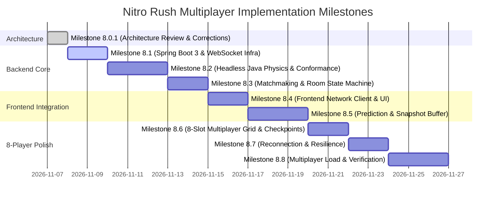

# NITRO RUSH — MULTIPLAYER DEVELOPMENT ROADMAP
## From Single-Player Arcade to 8-Player Real-Time Online Racing (Milestone 8.0.1 Revised)

---

## 1. Executive Implementation Strategy

The multiplayer transformation will be executed across phased, testable milestones to ensure that:
1. The verified single-player game (Milestones 1.0–7.8) remains 100% operational and regression-free.
2. The server-authoritative backend is developed iteratively, with an accumulator-based fixed timestep (50 ms) ensuring strict determinism.
3. Network synchronization (client prediction and snapshot interpolation) is calibrated with automated latency and jitter simulation before public testing.
4. Single-player starting grid (4 slots) remains untouched while a dedicated 8-slot staggered grid is introduced for multiplayer rooms.

---

## 2. Milestone Breakdown & Scope

### Milestone 8.1 — Backend Infrastructure & WebSocket Foundation
- **Scope:** Initialize Java 21 / Spring Boot 3 Maven backend in `Backend/`.
- **Deliverables:**
  - `pom.xml` with Spring Boot Starter WebSocket, Jackson, and JUnit 5.
  - `WebSocketConfig` mapping `/ws/game` with CORS origin filtering.
  - `ConnectionManager` handling session registration, heartbeats (`PING`/`PONG`), and graceful disconnects.
  - `GuestSessionManager` for issuing stateless cryptographic tokens.
  - Integration test verifying 100 concurrent WebSocket connections.

### Milestone 8.2 — Headless Java Physics Engine & Conformance Test Suite
- **Scope:** Pure Java 2D physics engine matching `CarController.ts` dynamics with accumulator-based fixed timestep.
- **Deliverables:**
  - Shared JSON config loader (`cars.json`, `tracks.json`).
  - `VehiclePhysicsEngine.java`: accumulator loop (50 ms), longitudinal/lateral speeds, drift yaw stabilization, grip multipliers, and mini-turbo awards.
  - `CollisionManager.java`: 2-pass mass-weighted impulse resolution with restitution and Coulomb friction.
  - `PhysicsConformanceSuite`: Automated cross-language test executing 9 deterministic test scripts (acceleration, braking, reverse transmission, steering agility ease curve, drift slip, nitro surge, mini-turbo award, off-road drag, and Titan vs Viper collision).
  - Strict verification: \(\Delta x, y \le 0.5\text{ px}\), \(\Delta v \le 0.1\text{ px/s}\), \(\Delta\theta \le 0.005\text{ rad}\), \(\Delta \text{nitro} \le 0.1\%\).

### Milestone 8.3 — Matchmaking Service & Room State Machine
- **Scope:** Multi-room orchestrator and public matchmaking queue.
- **Deliverables:**
  - `MatchmakingService.java` with 15-second collection window and immediate 8-player launch.
  - `Room.java` state machine (`WAITING`, `COUNTDOWN`, `RACING`, `FINISHED`, `CLOSED`).
  - Concurrency test evaluating 64 simulated players joining simultaneously without race conditions.

### Milestone 8.4 — Frontend Networking Layer & Matchmaking UI
- **Scope:** Frontend communication layer in `Frontend/src/multiplayer/`.
- **Deliverables:**
  - `NetworkClient.ts` with exponential reconnect backoff.
  - `MatchmakingScene.ts` displaying queue status and search spinner.
  - `MultiplayerLobbyScene.ts` with 8 car slots, ready toggles, and track preview.
  - Clean routing from `MainMenuScene.ts` into "ONLINE MULTIPLAYER".

### Milestone 8.5 — Real-Time Synchronization, Prediction & Interpolation
- **Scope:** High-performance client-side prediction and remote vehicle interpolation.
- **Deliverables:**
  - `InputBuffer.ts`: Ring buffer tracking unacknowledged inputs.
  - `PredictionReconciler.ts`: Local prediction with exponential decay error smoothing (\(e^{-\lambda t}\)).
  - `SnapshotBuffer.ts`: 100 ms jitter buffer with cubic Hermite spline interpolation for the other 7 racers.
  - Verification: 0 teleportation artifacts under 120 ms artificial ping and 30 ms jitter.

### Milestone 8.6 — 8-Player Race Orchestration & Checkpoint Validation
- **Scope:** Full 8-player racing on all 9 tracks.
- **Deliverables:**
  - Dedicated `MultiplayerGridConfig` providing staggered 8-slot grid (`P1` to `P8`) with zero single-player modification.
  - Server-authoritative checkpoint validation and anti-shortcut detection.
  - Live 8-car dynamic leaderboard and vector minimap with 8 colored pips.
  - `MultiplayerResultsScene.ts` podium and detailed timing cards.

### Milestone 8.7 — Reconnection, Fault Tolerance & Resilience
- **Scope:** Robustness under real-world network disruptions.
- **Deliverables:**
  - 15-second reconnection grace period in room engine.
  - Inert vehicle drag physics during network dropouts.
  - Reconnection handshake with immediate full-state resynchronization.
  - 30-second post-winner DNF countdown.

### Milestone 8.8 — Stress Testing, Load Verification & Acceptance
- **Scope:** Final acceptance testing and performance benchmarking.
- **Deliverables:**
  - Headless multi-client test harness simulating 8 concurrent players driving simultaneously.
  - Actual measured network bandwidth verification under TLS/WSS encryption.
  - Telemetry validation: 20 TPS tick rate stability under 50 active rooms.
  - Zero memory leaks across 10 consecutive full race lifecycles.
  - Final multiplayer acceptance sign-off.

---

## 3. Technology Choices & Justification

| Layer / Component | Chosen Technology | Alternatives Considered | Decision Rationale |
| :--- | :--- | :--- | :--- |
| **Backend Framework** | Java 21 + Spring Boot 3 | Node.js, Go, Rust | Java 21 Virtual Threads provide non-blocking I/O with exceptional concurrent connection density. High enterprise reliability, mature Jackson serialization, and seamless integration with existing Maven tools. |
| **Network Protocol** | WebSocket (JSON) | WebRTC (DataChannels), gRPC-Web, UDP | WebRTC DataChannels add substantial signaling complexity, STUN/TURN server requirements, and NAT traversal failure rates. At 20 Hz, optimized JSON over WebSocket provides sub-30ms latency with 100% firewall pass-through and universal browser support. |
| **Server Physics** | Pure Headless Java 21 | Running headless Phaser in Node.js | Running Phaser headlessly in Node/Puppeteer consumes excessive memory (300 MB per instance) and lacks CPU determinism. Pure Java vector math executes in < 1 ms per 8-car tick and consumes < 20 MB of heap per room. |
| **Snapshot Buffering** | 100 ms Fixed Delay Jitter Queue | Extrapolation / Dead Reckoning | Dead reckoning causes severe overshoots and erratic rubber-banding in high-speed racing games when vehicles corner or brake. Hermite interpolation over a 2-snapshot history provides butter-smooth visual fluidity. |

---

## 4. Unresolved Design Questions & Risk Assessment

### 4.1 Numerical Parity between TypeScript and Java Vector Math
- **Risk:** Floating-point differences between JavaScript (IEEE 754 64-bit floats in V8) and Java (`double`/`float`) could accumulate positional drift over long straights.
- **Mitigation:** The server reconciliation system automatically blends out positional errors larger than 2 pixels. Furthermore, Milestone 8.2 will include the cross-language `PhysicsConformanceSuite` verifying identical outputs for all car turn rates, drag exponents, and collision impulses.

### 4.2 Handling High-Ping Disparities in Vehicle-to-Vehicle Collisions
- **Risk:** If Player A has 20 ms ping and Player B has 150 ms ping, Player A might see a collision that Player B has not yet experienced locally.
- **Mitigation:** The server strictly resolves collisions at the authoritative server tick. The client prediction engine treats other cars as physical obstacles but respects the server's collision deflection impulse on the subsequent snapshot, preventing clients from "pushing through" other vehicles.

### 4.3 Peak Concurrency & Outbound WebSocket Bandwidth
- **Risk:** Large JSON snapshot payloads could saturate server network bandwidth during peak hours.
- **Mitigation:** The snapshot payload has been stripped of static data (no track coordinates, car configurations, or string labels). Coordinates and velocities are formatted as compact floats with at most 2 decimal places. A full 8-player snapshot is under 1,090 bytes uncompressed (approx. 22.7 KB/s wire bandwidth at 20 Hz).

---

## 5. Immediate Next Step: User Approval Gate

In accordance with the strict constraints of Milestone 8.0.1:
- **No application code has been written.**
- **No backend packages or Maven dependencies have been installed.**
- **No database or Docker containers have been launched.**
- **Existing single-player frontend files are 100% untouched.**

> [!IMPORTANT]
> **STOP AND WAIT FOR USER APPROVAL:**
> Work will stop here. Upon your explicit review and approval of the Milestone 8.0.1 Architecture Corrections, we will proceed to **Milestone 8.1: Backend Core Foundation & WebSocket Infrastructure**.
