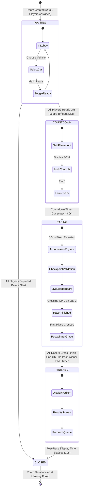
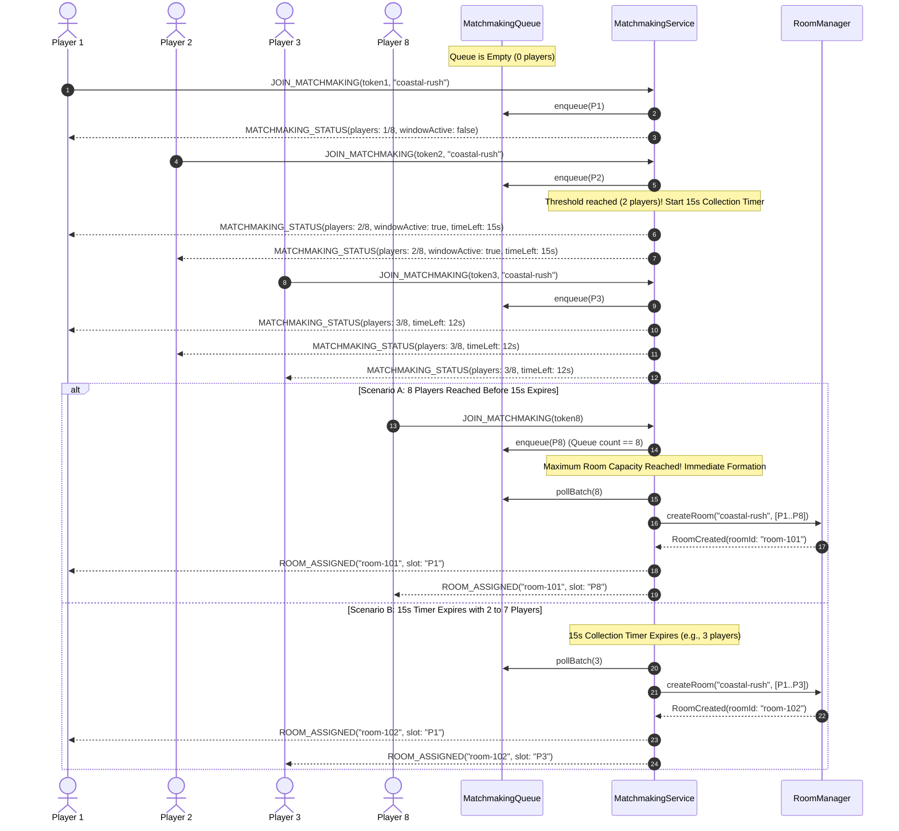

# NITRO RUSH — ROOM & RACE LIFECYCLE SPECIFICATION
## Milestone 8.0.1: Matchmaking, Room State Machine & Lifecycle Management (Revised)

---

## 1. Room State Machine Specification

A room orchestrates the multiplayer session across five formal lifecycle states:



### 1.1 Formal State Invariants & Transition Rules

| State | Entry Conditions | Allowed Client Actions | Server Operations & Invariants | Exit Triggers |
| :--- | :--- | :--- | :--- | :--- |
| **`WAITING`** | Matchmaking service groups 2–8 players and allocates a room ID. | `SELECT_CAR`, `PLAYER_READY`, `CANCEL_MATCHMAKING`. | Listens for car selections and ready status. Max wait timer (30s). Validates min 2 players. | **Transition to `COUNTDOWN`:** All joined players are ready, OR 30s timeout expires with \(\ge 2\) ready players. |
| **`COUNTDOWN`** | Lobby timer expires or all players ready. | None (controls locked). Local client displays 3-2-1 animation. | Spawns vehicles on the 8-slot multiplayer starting grid (`P1`–`P8`). Locks physics velocities to zero. Ticks 3-second synchronized timer. | **Transition to `RACING`:** Exactly 3.0 seconds elapse. `RACE_STARTED` broadcast sent. |
| **`RACING`** | Countdown reaches zero. | `PLAYER_INPUT` (throttle, brake, steer, drift, nitro). | Executes accumulator-based 20 TPS physics loop (\(\Delta t = 50\text{ ms}\)), multi-car collisions, checkpoint tracking, lap completion, and 20 Hz snapshot broadcasts. | **Transition to `FINISHED`:** All players cross finish line on Lap 3, OR 30 seconds elapse after 1st place finishes. |
| **`FINISHED`** | All active players finished or DNF timer expires. | View final podium, inspect lap records, click "Rematch" or "Main Menu". | Computes final results rankings, assigns `DNF` to incomplete racers, stops physics loop, persists match statistics. | **Transition to `CLOSED`:** 20-second results display window elapses or all players disconnect. |
| **`CLOSED`** | Results window expires or room aborted. | Disconnected; client transitions to Main Menu. | Unregisters room from `RoomManager`, disposes `RaceEngine`, cleans session mappings. | Room instance destroyed. |

---

## 2. Public Matchmaking Workflow

The public matchmaking system gathers players globally, creates rooms efficiently, and eliminates race conditions.



### 2.1 Concurrency & Simultaneous Join Protection
- **Lock-Free Contention Resolution:** `MatchmakingQueue` uses Java's `ConcurrentLinkedQueue` combined with a synchronized match-maker tick loop.
- **Atomic Dequeue:** The creation of a room atomically polls up to 8 racers from the head of the queue. If a player disconnects or cancels right before polling, the poll skips invalid tokens without blocking or failing other players.
- **Fairness & FIFO Guarantee:** Players are always ordered strictly by the millisecond timestamp when their request was received by the server. No priority jumping is permitted.
- **Track Selection Resolution:** In public matchmaking, the room track is resolved by popular vote among the joined players. Ties are resolved deterministically using hash priority on the track ID.

---

## 3. Dedicated Multiplayer Starting Grid Specification (Preserving Single-Player Grid)

### 3.1 Single-Player Grid Preservation
- Offline single-player mode uses the existing 4-slot grid defined in `TrackGeometry.ts` (`startGridPositions: GridSlot[]` with `P1` through `P4`).
- **Single-player geometry remains 100% untouched.**

### 3.2 Multiplayer Eight-Slot Staggered Grid Configuration
Multiplayer rooms spawn vehicles on a separate 8-slot grid (`MultiplayerGridConfig`):
- **Staggered 2-Column Alignment:**
  - Left Column (P1, P3, P5, P7): Lateral offset \(-28\text{ px}\) from track centerline.
  - Right Column (P2, P4, P6, P8): Lateral offset \(+28\text{ px}\) from track centerline.
  - Longitudinal spacing: \(60\text{ px}\) between consecutive rows:
    - P1: \(90\text{ px}\) behind Checkpoint 0
    - P2: \(150\text{ px}\) behind Checkpoint 0
    - P3: \(210\text{ px}\) behind Checkpoint 0
    - P4: \(270\text{ px}\) behind Checkpoint 0
    - P5: \(330\text{ px}\) behind Checkpoint 0
    - P6: \(390\text{ px}\) behind Checkpoint 0
    - P7: \(450\text{ px}\) behind Checkpoint 0
    - P8: \(510\text{ px}\) behind Checkpoint 0
- **Collision-Free Spacing Proof:**
  - Adjacent diagonal distance: \(\sqrt{60^2 + 56^2} \approx 82.07\text{ px}\).
  - Vehicle collision diameter: \(44\text{ px}\) (radius \(22\text{ px}\)).
  - Safety clearance: \(82.07 - 44 = 38.07\text{ px} > 0\). **Zero initial collisions.**
- **Track Width Validation:**
  - Narrowest road is Mountain Pass (\(130\text{ px}\) width \(\to 65\text{ px}\) half-width).
  - Outermost car boundary is at \(28\text{ (center)} + 18\text{ (half-car)} = 46\text{ px}\).
  - Margin to curb: \(65 - 46 = 19\text{ px}\). Vehicles spawn safely on the asphalt on all 9 tracks.

---

## 4. Disconnection & 15-Second Reconnection Lifecycle

Network dropouts on mobile or Wi-Fi must not immediately ruin the experience for the racer or other competitors in the room.

```mermaid
sequenceDiagram
    autonumber
    actor Racer as Disconnected Racer
    participant Server as Room (State: RACING)
    actor Peers as Remaining 7 Racers

    Note over Racer: Wi-Fi Glitch / Connection Lost
    Server->>Server: Heartbeat timeout / WebSocket closed
    Note over Server: Start 15-second grace countdown handle
    Server->>Server: Set vehicle to INERT mode (natural rolling drag)
    Server-->>Peers: Broadcast PLAYER_DISCONNECTED(playerId, timeLeft: 15s)

    alt Racer Reconnects within 15 Seconds
        Note over Racer: Network restored; sends RECONNECT
        Racer->>Server: RECONNECT(roomId, guestToken, lastTick)
        Server->>Server: Validate token & cancel 15s timeout handle
        Server->>Server: Bind new WebSocket session to PlayerSlot
        Server-->>Racer: Full State Resynchronization Snapshot
        Server-->>Peers: Broadcast PLAYER_RECONNECTED(playerId)
        Note over Racer: Racer resumes driving immediately!
    else 15 Seconds Elapses with No Reconnection
        Note over Server: Grace timer fires at T = 15.0s
        Server->>Server: Mark racer status = DNF
        Server->>Server: Remove vehicle from active physics simulation
        Server-->>Peers: Broadcast PLAYER_LEFT(playerId, reason: "TIMEOUT")
    end
```

### 4.1 Inert Vehicle Safety Physics
When a player disconnects during `RACING`:
- Their inputs are set to zero (`throttle = 0`, `brake = 0`, `steer = 0`, `drift = false`, `nitro = false`).
- Vehicle continues along its momentum vector subject to standard road drag (`0.988`).
- The vehicle collision radius remains active, meaning other cars can push past it or bounce off it realistically, preventing arbitrary phasing exploits.

---

## 5. Post-Race & Winner Handling (30s DNF Timer)

To prevent rooms from hanging indefinitely when one player stops driving or wanders off track:
1. When the 1st place competitor crosses the finish line on Lap 3:
   - The winner receives `RACE_FINISHED` with 1st place confirmation.
   - The server activates a **30-second post-winner countdown**.
   - A visual notice (`"LEADER FINISHED! 30s REMAINING"`) is broadcast in the snapshot header.
2. Any player who completes Lap 3 before the 30-second timer expires receives their actual finishing position (2nd, 3rd, 4th, etc.).
3. When the 30-second timer hits zero:
   - Any racers who have not completed Lap 3 are immediately flagged as `DNF` (Did Not Finish).
   - `DNF` players are ranked behind all finished racers, ordered by their total sector progress score.
   - The room transitions immediately to `FINISHED`.
